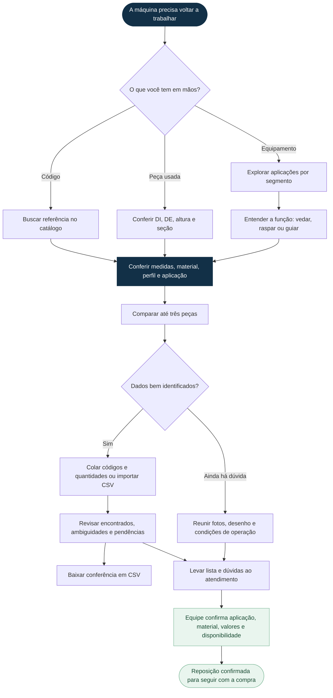
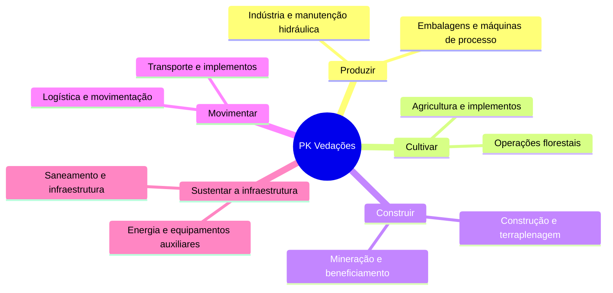

# Jornada visual PK

Fluxogramas aprovados pelo proprietário. A interface correspondente usa HTML semântico, links e seleção por rádio para manter texto legível, teclado e navegação no celular, sem dependência de renderização de terceiros. A rota pública é `/como-escolher`; o resumo fica na home. Nenhuma etapa cria um pedido automaticamente.

## Verificação

Cobertura única dos dez segmentos e destinos da jornada em testes de domínio. Navegador CI verifica as três entradas, navegação por teclado, caminhos para guias/catálogo/aplicações, mapa de segmentos, canonical, isolamento de tenant e ausência de overflow em 390 e 1440 px. O controle e as fontes da entrega anterior permanecem preservados.
